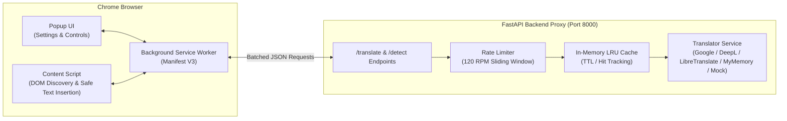

# Universal Translator (Chrome Extension & Backend Proxy)

[](https://developer.chrome.com/docs/extensions/mv3/intro/)
[](https://fastapi.tiangolo.com)
[](LICENSE)

Universal Translator is a Manifest V3 Chrome extension that detects foreign-language text on webpages and translates it into English. It features automatic translation on page load, on-demand manual translation, side-by-side original-versus-English comparison, dynamic content observation, and non-destructive page restoration.

---

## Architecture Overview



---

## Key Features

- **Language Detection (FR-01):** Analyzes HTML attributes, meta tags, and text samples. Skips English pages automatically.
- **Manual Page Translation (FR-02):** One-click translation of eligible text with live progress feedback in the popup.
- **Automatic Translation (FR-03):** Translates foreign pages on load, with a debounced `MutationObserver` handling dynamic content (SPAs) without infinite loops.
- **Original & English Comparison (FR-04):** Displays original text alongside English via inline badges `[EN: ...]`, subtitle blocks, or hover tooltips. Form controls, code blocks (`<pre>`, `<code>`), scripts, and styles are strictly preserved.
- **Restoration (FR-05):** Instantly restores original text nodes and removes extension elements without needing a page reload.
- **Secure Backend Proxy (FR-07):** Protects API credentials, caches translations, applies rate limiting, and validates batch payloads. Zero credentials needed for local testing out-of-the-box via MyMemory/Mock fallbacks.
- **Multi-Device & Chrome Web Store Ready (FR-08):** Packaged with high-resolution icons (16, 32, 48, 128 px), accessible UI, and an automated `.zip` generator.

---

## Directory Structure

```text
Language Screen converter/
├── extension/                   # Manifest V3 Chrome Extension
│   ├── manifest.json            # Extension metadata and permissions
│   ├── background.js            # Background service worker (messaging & cache)
│   ├── content.js               # Safe DOM discovery, batching & restoration
│   ├── content.css              # Badge, subtitle, and tooltip styling
│   ├── popup.html               # Accessible popup interface
│   ├── popup.css                # Popup stylesheet (WCAG AA compliant)
│   ├── popup.js                 # Settings persistence & tab coordinator
│   └── icons/                   # Extension icons (16px, 32px, 48px, 128px, SVG)
├── backend/                     # Python FastAPI Backend Proxy
│   ├── app/
│   │   ├── main.py              # FastAPI app with routes & CORS
│   │   ├── config.py            # Environment configuration
│   │   ├── schemas.py           # Pydantic request/response models
│   │   ├── services/
│   │   │   ├── translator.py    # Multi-provider translation service
│   │   │   ├── cache.py         # Thread-safe LRU & TTL cache
│   │   │   └── rate_limiter.py  # Sliding window rate limiter
│   │   └── tests/
│   │       └── test_api.py      # Automated backend unit tests
│   ├── requirements.txt         # Python dependencies
│   ├── .env.example             # Template for API keys & settings
│   └── run.py                   # Server startup script
├── test-pages/                  # Multilingual HTML test fixtures
│   ├── test-german.html         # German article with code blocks & forms
│   ├── test-french.html         # French travel page
│   ├── test-spanish.html        # Spanish technology article
│   ├── test-japanese.html       # Japanese blog post
│   ├── test-english.html        # Page already in English (no-op check)
│   └── test-dynamic.html        # Dynamic SPA test with live DOM additions
├── scripts/
│   ├── generate_icons.py        # Icon generator using Pillow
│   └── package_extension.py     # Production ZIP packager for Chrome Web Store
├── tests/
│   ├── test_content_logic.js    # Node.js DOM filter & batch tests
│   └── run_tests.py             # Unified frontend & backend test runner
├── PRIVACY.md                   # Privacy policy and permissions disclosure
└── README.md
```

---

## Installation & Setup

### Step 1: Start the Backend Proxy

1. Open a terminal in the project folder and navigate to `backend`:
   ```bash
   cd backend
   pip install -r requirements.txt
   ```

2. *(Optional)* Configure your translation provider by editing `.env`.  
   By default, `TRANSLATION_PROVIDER=auto` works out of the box without any paid key using free public translation with automatic fallback to mock translation. If you have an API key:
   ```env
   # Google Cloud
   GOOGLE_TRANSLATE_API_KEY=your_key_here

   # Or DeepL
   DEEPL_API_KEY=your_key_here
   ```

3. Launch the backend server:
   ```bash
   python run.py
   ```
   The backend will be active at `http://127.0.0.1:8000`. You can inspect the Swagger documentation at `http://127.0.0.1:8000/docs`.

---

### Step 2: Load the Extension in Google Chrome

1. Open Google Chrome and navigate to `chrome://extensions`.
2. Toggle the **"Developer mode"** switch in the top-right corner.
3. Click the **"Load unpacked"** button in the top-left toolbar.
4. Select the `extension/` folder inside this repository:
   ```text
   c:\Users\sksar\Desktop\Language Screen converter\extension
   ```
5. The **Universal Translator** icon will appear in your Chrome toolbar. Pin it for easy access.

---

## Multi-Device Installation

To install on another workstation or device:
- **Developer mode:** Copy or git-clone the repository to the second device, repeat the "Load unpacked" step above, and ensure the backend URL points to your running backend (e.g. `http://localhost:8000` or a deployed host).
- **Chrome Web Store / Zip distribution:** Run `python scripts/package_extension.py` to create a production `.zip` in the `dist/` directory, ready for distribution or Web Store upload.

---

## Testing & Verification

### Running the Test Suite
Run the unified test runner to execute both backend and frontend test suites:
```bash
python tests/run_tests.py
```

### Manual Testing with Test Pages
Open the fixtures in `test-pages/` using your browser:
- `test-pages/test-german.html`: Verifies German translation, code block exclusion, and form preservation.
- `test-pages/test-french.html`: Verifies French translation.
- `test-pages/test-spanish.html`: Verifies Spanish translation.
- `test-pages/test-japanese.html`: Verifies Japanese script translation.
- `test-pages/test-english.html`: Verifies that already-English pages are detected and left unmodified.
- `test-pages/test-dynamic.html`: Click "Neues deutsches Element hinzufügen" to verify that the MutationObserver translates newly added elements automatically without loops.

---

## Privacy & Security

- **No Secrets in Client:** API credentials reside strictly on the backend.
- **Safety First:** Form fields, passwords, content-editable blocks, and code tags are never extracted or sent.
- **Text Rendering:** Translated text is inserted strictly as text nodes (`textContent`), preventing XSS vulnerabilities.
- For complete privacy details, refer to [PRIVACY.md](PRIVACY.md).
